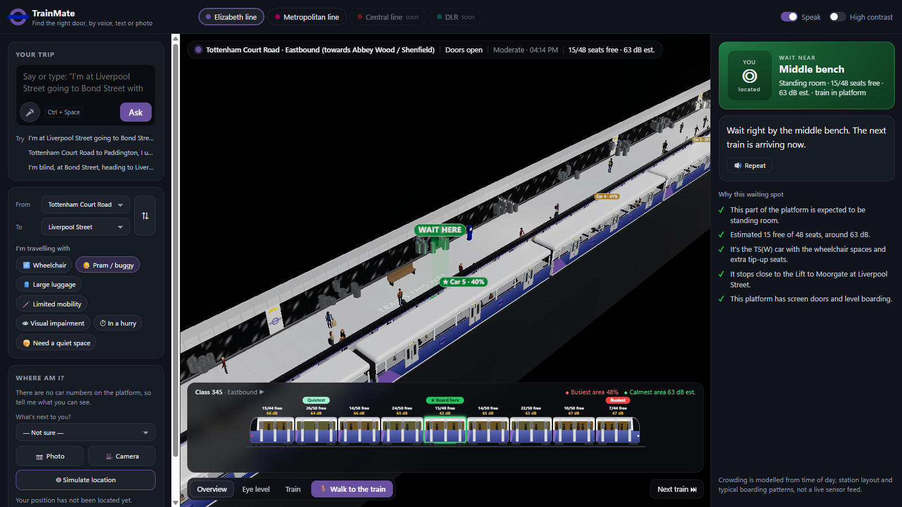
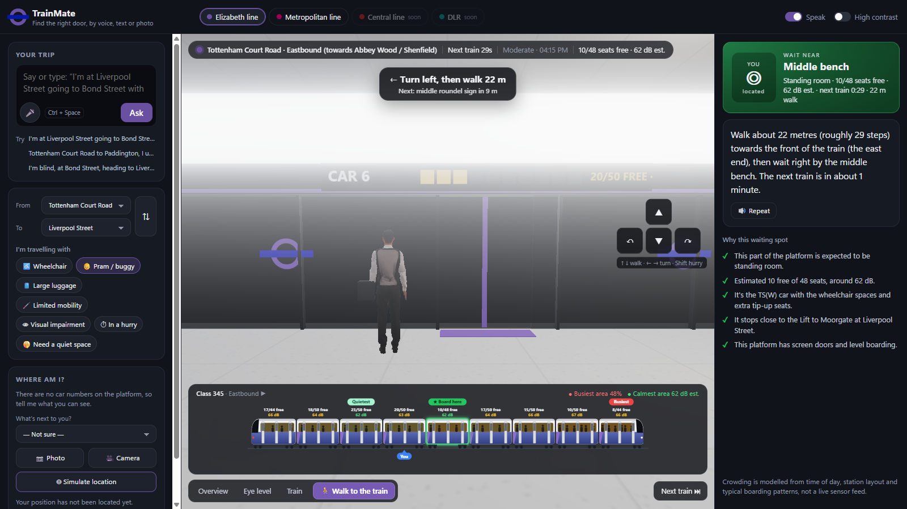
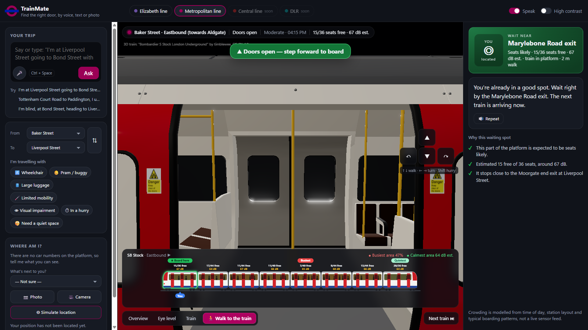
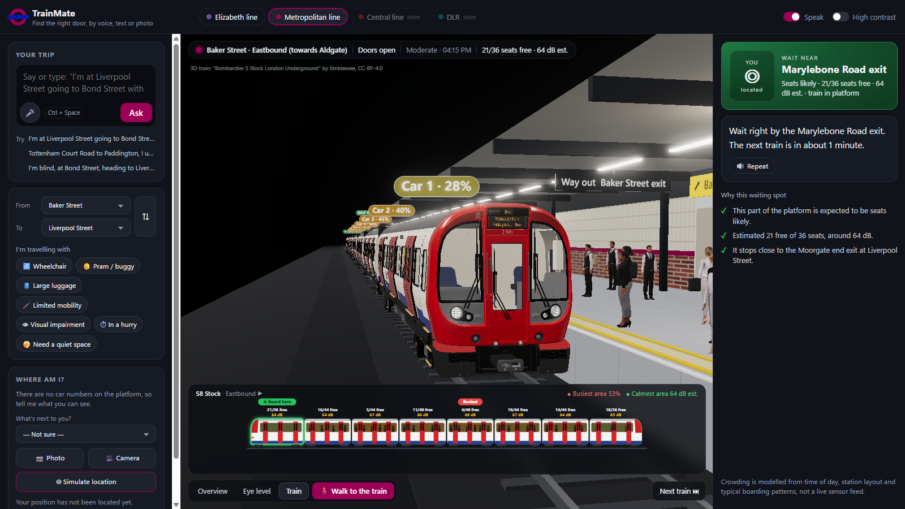

# TrainMate: find the right door before the train arrives



## Why we built this

You're on the platform, the board says two minutes, and you have to pick a spot. You don't know
which carriage will have space. So you guess. The doors open in front of a packed carriage, and
three carriages down there are empty seats you'll never reach in time.

For most of us that's just annoying. For a lot of people it decides how the whole journey goes:

- **If you're pregnant**, standing for twenty minutes in a swaying, packed carriage is the last thing
  you need, and you can't always count on someone noticing and giving up a seat.
- **If you're pushing a buggy or holding a child's hand**, you need a carriage with floor space by
  the door, not one where you'll be wedged in with a pram nobody can get past.
- **If you're older, or walking with a stick**, you need a seat, and you need to get to the right
  door without rushing the length of the platform.
- **If you use a wheelchair**, only certain carriages have the space. On the Elizabeth line it's the
  middle carriage. If you're waiting at the wrong end, you may not make it.
- **If loud, crowded spaces are hard for you**, a calmer carriage can make the difference between
  a manageable journey and an overwhelming one.

And then there's rush hour. At 8:30 the train pulls in full, you can't squeeze on, and you watch it
leave. The next one is just as full. Now you're late for work, and nothing you did caused it. Often
there *was* room on that first train, just not where you were standing.

London platforms don't mark carriage numbers, so "stand by car 5" means nothing when you're there.
TrainMate tells you where to stand in terms of what you can actually see (an exit sign, a bench, a
lift) and walks you there, before the train arrives.

## What it does

- **Ask the way you'd ask a person.** Say or type *"I'm at Tottenham Court Road going to Liverpool
  Street with a pram."* Gemini works out where you are, where you're going and what you need.
- **It picks the carriage for you.** It weighs how crowded each carriage is likely to be, free
  seats, noise, wheelchair and buggy spaces, and which carriage stops nearest the exit or lift at
  your destination.
- **Directions use landmarks, not car numbers.** *"Turn left, walk 22 metres past the roundel sign,
  wait by the middle bench."* It speaks them out loud, with step counts for blind and partially
  sighted passengers.
- **Point your camera at the platform.** Gemini Vision recognises the signs, exits and benches
  around you and works out where you're standing.
- **See the whole train before it arrives.** A side view of the train shows each carriage: how
  full it is, how many seats are likely free, and how loud it is inside.







Lines in the demo: **Elizabeth line** (Class 345) and **Metropolitan line** (S8 Stock).
Built for Track 2: Multimodal & Human-Centric AI, with the Gemini model family.

> Crowding, seats and noise are modelled estimates (time of day, station layout, typical boarding
> patterns), not live sensor data. Station landmark positions are approximate.

## Run

```bash
cp .env.example .env.local   # then paste your Gemini API key into .env.local
npm install
npm run dev                  # http://localhost:5173
```

Without a key the 3D scene, menus and crowding model still work; voice, text understanding and photos need Gemini.
Model IDs are in `src/config.ts`.

## How it works

| Piece | File | Gemini? |
|---|---|---|
| Understand the trip from speech or text (station, destination, needs) | `src/gemini.ts` `parseRequest` | Audio/text → JSON |
| Locate the user on the platform from a photo or camera frame | `locateOnPlatform` | Vision → JSON |
| Rebuild a platform's 3D layout from a walk of photos | `rebuildPlatform` | Multi-image vision → JSON |
| Turn the plan into calm spoken directions (step counts for blind users) | `composeGuidance` | Text |
| Expressive speech output | `speak` | TTS |
| Estimated per-car crowding | `src/engine/crowding.ts` | — |
| Best car + landmark-based directions | `src/engine/recommend.ts` | — |
| Procedural 3D platform + live arriving train | `src/scene.ts` | — |

Crowding is **modelled**, not measured: time of day, where people walk onto the platform, emptier
end cars, and per-train randomness. Station landmark positions in `src/data/network.ts` are
**illustrative** and should be checked on site or rebuilt from photos.

## 3-minute demo script

1. Press **🎤 Speak**: "I'm at Liverpool Street going to Bond Street with a pram."
2. TrainMate answers out loud and the 3D view highlights the spot; the car bars show the crowding.
3. **📷 Upload photo** of the platform → "You're by the roundel, walk 20 metres towards the front…" and the view drops to eye level.
4. Turn on **High contrast**, ask as a blind user ("I'm blind, at Bond Street, heading to Liverpool Street") → directions with step counts.
5. Drag **Simulated time** to 08:30 vs 14:00 to show crowding changing; press **Next train ⏭** to watch a train arrive.
6. Optional: **🧱 Rebuild platform from photos** with 4–8 photos taken along a platform.

Shortcut: **Ctrl+Space** toggles the microphone.

## Walk-to-the-train demo

Press **🚶 Walk to the train**. You start where you'd walk onto the platform (the lift for step-free
needs, otherwise a street exit or interchange) and get turn-by-turn guidance with spoken cues as you
pass landmarks. ↑/↓ walk, ←/→ turn, drag to look, Shift to hurry. At the green circle the next
train is brought in, the doors open, and stepping forward boards the train; it then leaves with you on it.

Handy URL parameters for rehearsing: `?line=metropolitan`, `?needs=pram`, `?view=walk`,
`?autowalk=1` (follows the guidance hands-free), `?train=here` (a train already in the platform).

## Data and credits

- Elizabeth line Class 345 dimensions, formation and interior layout: TfL *Class 345 Data Sheet ver 3* (FOI-0416-2223).
- Metropolitan line S8 Stock dimensions and formation: TfL *S Stock information sheet, July 2010* (FOI-0158-2021).
- 3D model: This work is based on ["Bombardier S Stock London Underground"](https://sketchfab.com/3d-models/bombardier-s-stock-london-underground-a6718eff2dc843c48fd54376b4c70b06) by [timblewee](https://sketchfab.com/timblewee), licensed under [CC-BY-4.0](http://creativecommons.org/licenses/by/4.0/). Used for the Metropolitan line train (intermediate cars are derived from the driving car by hiding the cab and stretching to the data-sheet length).
- People near the camera use the free rigged models from [Renderpeople](https://renderpeople.com/free-3d-people/) (Eric, Carla, Claudia), posed and baked at load time. **Local demo only:** Renderpeople's terms (4.3b) forbid making the model files easily downloadable by third parties, so `public/models/people/` is git-ignored and must not be deployed to a public site. Without those files the app falls back to simple figures.

